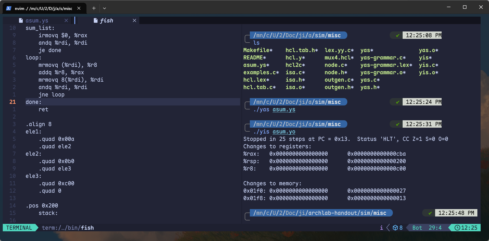
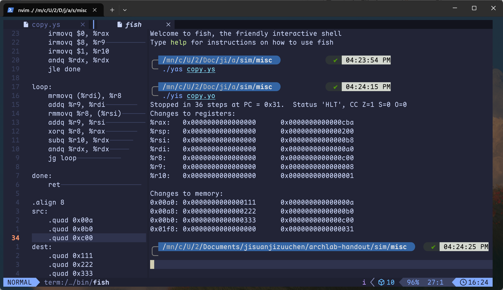

# Y86-64汇编

>  这次实验报告看上去需要开始手撕汇编，感觉不赖

本实验核心是把examples.c里的两个c函数翻译成Y86-64汇编

## example.c

先来审计读下c源码的两个功能

### 1. sum_list 求链表所有元素之和

```c
typedef struct ELE {
    long val;
    struct ELE *next;
} *list_ptr;

long sum_list(list_ptr ls)
{
    long val = 0;
    while (ls) {
        val += ls->val;
        ls = ls->next;
    }
    return val;
}
```

作用：

- 遍历一个单向链表，把每个节点的val累加起来，返回总和
- list_ptr是指向链表节点的指针，节点包含一个long类型的值val，和一个指向下一个节点的指针next
- 循环条件：while (ls)表示只要当前指针非空（即还没到链表末尾）就继续
- 每次循环：把当前节点的val加到累加器val上，然后ls移动到下一个节点

### 2. copy_block 复制内存块并返回异或校验和

```c
long copy_block(long *src, long *dest, long len)
{
    long result = 0;
    while (len > 0) {
        long val = *src++;
        *dest++ = val;
        result ^= val;
        len--;
    }
    return result;
}
```

作用：

- 从src指向的内存区域复制len个long到dest指向的区域
- 计算所有被复制值得异或校验和，并返回
- `*src++`表示先取src指向得值，然后src指针自增，指向下一个long
- `*dest++=val`表示把val写入dest指向得位置，然后dest自增
- `result ^= var`把每个值异或到result中
- `len--`递减计数，直到len==0

## sum.ys

代码原理审计完了，开始尝试手写汇编实现它

一个Y86-64程序通常由三部分组成：栈初始化、调用main、halt，数据放在最后

```asm
.pos 0
    irmovq stack, %rsp
    call main
    halt

main:
    irmovq ele1, %rdi
    call sum_list
    ret

sum_list:
    irmovq $0, %rax
    andq %rdi, %rdi
    je done
loop:
    mrmovq (%rdi), %r8
    addq %r8, %rax
    mrmovq 8(%rdi), %rdi
    andq %rdi, %rdi
    jne loop
done:
    ret

.align 8
ele1:
    .quad 0x00a
    .quad ele2
ele2:
    .quad 0x0b0
    .quad ele3
ele3:
    .quad 0xc00
    .quad 0

.pos 0x200
    stack:

```

详细说说我是怎么手搓出来的

上网查过了，Y86-64是CSAPP里为了教学设计的一种简化版 x86-64汇编，它保留了x86-64的核心思想，但是指令少得多，方便我们手写和理解

这里的寄存器和部分指令倒是和上学期学的差不多，我就不多说了，具体的看下文

一个Y86-64汇编程序通常长这样：

```asm
.pos 0                    # 代码从地址 0 开始
    irmovq stack, %rsp    # 初始化栈指针
    call main             # 调用 main
    halt                  # 程序结束

main:
    ...                   # main 的代码
    ret

sum_list:
    ...                   # 函数代码
    ret

.align 8                  # 数据按 8 字节对齐
ele1:
    .quad 0x00a           # 一个 8 字节数据
    .quad ele2            # 另一个 8 字节数据（这里是地址）

.pos 0x200                # 栈从 0x200 开始
stack:
```

上面只是大纲，我详细说几个特别的伪指令，它们似乎是Y86-64的特色

| 伪指令     | 作用                 |
| ---------- | -------------------- |
| `.pos N`   | 把当前位置设到地址 N |
| `.align 8` | 对齐到 8 字节边界    |
| `.quad V`  | 放一个 8 字节的值 V  |

`.quad` 可以放**常数**，也可以放**标签地址**（如 `ele2`），汇编器会把它替换成实际地址

然后我从C到汇编的翻译方法如下：

1. 分配寄存器

| 变量     | 寄存器 |
| -------- | ------ |
| ls       | %rdi   |
| val      | %rax   |
| 临时变量 | %r8    |

2. 翻译`val=0`

```asm
irmovq $0, %rax
```

汇编中最长使用mov进行寄存器赋值，上面操作将立即数0存到寄存器rax中，方便后面调用

3. 翻译 `while(ls)`

这是进入循环之前的一次判断

```asm
andq %rdi, %rdi
je done
```

自己和自己与，只是为了设置ZF，如果ZF=1，说明结果为0，je就会跳转

在x86里，我们一般用cmp比较两个寄存器的值，这里是由于y86没有那个cmp指令，因此才用and进行与运算

je跳转的done代表循环结束，直接退出

4. 循环体

```asm
loop:
	mrmovq (%rdi), %r8   # %r8 = ls ->val
	addq %r8, %rax       # val += %r8
	mrmovq 8(%rdi), %rdi # ls = ls->next
```

先将链表ls_1的值保存在临时寄存器%r8里，然后用add加在rax寄存器里

`mrmovq 8(%rdi), %rdi`这步操作挺极限的，先说说结构体

```c
strcut ELF{
	long val;        //8字节
	sturct ELF *next;//8字节
}
```

在运行该命令之前，我们的rdi指向的是ls_1这个结构体的第一部分，然后我们给它向后偏移8字节，是不是指向那个next指针？这就是`8(%rdi)`的作用，然后使用mov将next指针传递给rdi里，对它进行值的更新

5. 进行循环条件再判

```asm
andq %rdi, %rdi
jne loop
```

只要结构体数值没加完，这里都会一直跳转到loop开始，继续上面的操作

jne和je的作用完全相反，只要ZF=0才跳转，也就是说`rdi!=0`才跳，否则就不走loop

6. 返回

```asm
done:
	ret
```

这个时候，%rax已经是返回值了，直接用ret跳出来就可以了

最终函数：

```asm
sum_list:
    irmovq $0, %rax
    andq %rdi, %rdi
    je done
loop:
    mrmovq (%rdi), %r8
    addq %r8, %rax
    mrmovq 8(%rdi), %rdi
    andq %rdi, %rdi
    jne loop
done:
    ret
```

仔细查看，会发现sum_list没有主动调用loop啊，为啥能正常进入循环体呢？原因是这里的汇编和高级语言的调用有区别，sum_list,loop,done这些东西都属于标签，并没有特殊意义，当sum_list那个je判断认为rdi非0，就会按照指令顺序进入loop段，而不是跳转done

函数段基本上讲完了，开始讲讲数据部分

```asm
.align 8
ele1:
    .quad 0x00a       # val = 10
    .quad ele2        # next = ele2 的地址
ele2:
    .quad 0x0b0       # val = 176
    .quad ele3
ele3:
    .quad 0xc00       # val = 3072
    .quad 0           # next = NULL
```

我前面说好的struct不可能无中生有吧，很显然，我必须提前定义好，这里我就定义三个struct，它们的next指针我是按照链表结构顺序弄的，然后最后一个next指针为0，代表链表结束

这部分的内存布局就长这样

```
ele1:  [10] [地址 ele2]
ele2:  [176] [地址 ele3]
ele3:  [3072] [0]
```

最后看看程序入口

```asm
.pos 0
    irmovq stack, %rsp    # 栈指针指向 stack
    call main             # 调用 main
    halt                  # main 返回后到这里停
```

这部分其实是固定的，几乎每个汇编都这样，这仅仅是入口，而不是主函数逻辑

我们需要给main里定义，让它执行sum_list，同时传递struct列表第一个元素作为参数进去

```asm
main:
    irmovq ele1, %rdi
    call sum_list
    ret
```

然后在整个汇编结束的地方，我们需要申明栈的起始地址，为啥我要写0x200呢？因为如果申请的小了，栈在向上增长的时候，可能会覆盖掉数据部分的内容，造成结构体污染，这里务必要让栈和函数空间保持一定的距离

```asm
.pos 0x200
    stack:
```

编译运行看看



这部分输出还是挺好读的

```
Stopped in 25 steps at PC = 0x13.  Status 'HLT', CC Z=1 S=0 O=0
Changes to registers:
%rax:   0x0000000000000000      0x0000000000000cba
%rsp:   0x0000000000000000      0x0000000000000200
%r8:    0x0000000000000000      0x0000000000000c00

Changes to memory:
0x01f0: 0x0000000000000000      0x0000000000000027
0x01f8: 0x0000000000000000      0x0000000000000013
```

先看看前后rax的变化，初始为0，结束的时候是0xcba，恰好是**10 + 176 + 3072 = 3258 = 0x0cba**

然后rsp一直指向栈顶，程序运行到最后，恰好回到了栈的初始位置，0x200就是我们定义的那个地址

r8寄存器仅仅记录临时变量的值，按照链表顺序，最后一次要传递的值是不是ele3的0xc00呢？而且我后面并没有清零操作，这意味着r8会一直保持那个值

然后看看栈上的内存变化

这两处是**栈上压入的返回地址**，说明 `call` 正常工作了。我们算一下：

- `%rsp` 初始是 `0x200`
- `call main` 时：`%rsp = 0x1f8`，写入 `halt` 的地址
- `call sum_list` 时：`%rsp = 0x1f0`，写入 `main` 中 `call` 的下一条指令地址

## copy.ys

这部分手写汇编内容如下：

```asm
.pos 0
    irmovq stack, %rsp
    irmovq src, %rdi
    irmovq dest, %rsi
    irmovq $3, %rdx
    call copy_block
    halt


copy_block:
    irmovq $0, %rax
    irmovq $8, %r9          
    irmovq $1, %r10
    andq %rdx, %rdx
    jle done

loop:
    mrmovq (%rdi), %r8
    addq %r9, %rdi        
    rmmovq %r8, (%rsi)      
    addq %r9, %rsi          
    xorq %r8, %rax        
    subq %r10, %rdx      
    andq %rdx, %rdx     
    jg loop           

done:
    ret                    

.align 8
src:
    .quad 0x00a
    .quad 0x0b0
    .quad 0xc00
dest:
    .quad 0x111
    .quad 0x222
    .quad 0x333

.pos 0x200
stack:
```

我在sum.ys部分写得过程还是复杂了不少，我在copy这里写简单点

故事的起点，那就是初始化一系列指针，参数然后调用函数呗

```asm
.pos 0
	irmovq stack, %rsp
	irmovq src, %rdi
	irmovq dest, %rsi
	irmovq $3, %rdx
	call copy_block
	halt
```

初始化栈指针，这是必须操作，包括最后程序调用结束回到halt一样，这些死记硬背哈

然后中间那几个是在设置参数，比如说我第一个参数src放在了rdi寄存器中，dest在rsi寄存器中，然后len在第三个寄存器中，这完全对应此处的函数签名

```c
long copy_block(long *src, long *dest, long len)
```

但是为啥我直接给len赋值为3呢？因为我看过实验报告，后面指定测试的数据一共三个，倘若我们后面再定义len，也是同样想办法往里面塞一个3，那么倒不如初始化申明阶段就直接赋值3呢

接下来我直接call，跳转copy_block函数中

在这里我们得提前标记几个变量

```asm
# long copy_block(long *src, long *dest, long len)
#   src  -> %rdi
#   dest -> %rsi
#   len  -> %rdx
#   result -> %rax
#   val  -> %r8
copy_block:
	irmovq $0, %rax
	irmovq $8, %r9
	irmovq $1, %r10
	andq %rdx, %rdx
	jle done
```

这里第一条指令给rax赋值0.它对应的是`long result=0;`

然后我给r9赋值8，这是为了指针自增，还记得这里的变量都是long型吗？一个元素8字节，如果不这样设置，会导致指针自增偏移失败，然后我又给数字1找了一个寄存器，谁会用到这个呢？没错，就是len--，它本质是len=len-1

接下来的andq可以返回len的具体状态，严格来说是len和0的关系

倘若len<=0，会触发jle done，直接程序结束，如果len>0，这个程序会继续下去，至于下面就是loop循环体以及done结束了

```asm
loop:
	mrmovq (%rdi), %r8
	addq %r9, %rdi
	rmmovq %r8, (%rsi)
	addq %r9, %rsi
	xorq %r8, %rax
	subq %r10, %rdx
	andq %rdx, %rdx
	jg loop
	
done:
	ret
```

> 有个细节得补充，mrmovq和rmmovq是截然相反的合法movq指令,很好区分的，mrmovq代表它是从memory -> register，rmmovq代表它是从register -> memory

那么我先将第一个参数传递给了r8寄存器，然后用addq给rdi向后偏移了8字节，指向了source里的第二个long元素

这对应代码：`long val =*src++`

温馨提示，这里先是给val赋值后，才给src自增，指向第二个值

然后看rmmovq，它将r8寄存器里的值传递给第二个参数rsi中了，这恰好是目标dest，然后是同样的add操作，给rsi向后偏移8字节进入dest的第二个元素

这对应代码：`*dest++ = val;`

这两步操作结束后，就要考虑`result ^= val`是怎么弄的了

先化简下，`result = result ^ val`,这里的result是不是先被赋值为0记录在rax寄存器中了？然后我xor的时候，val都在r8里对吧，那么对应指令应该是

`xorq %r8, %rax`

接下来来到`len --`，这个简单，`subq %r10, %rdx`

等这些操作结束，我们是不是应该做个判断？判断len是否为0，如果变成个0了，那么就不能再循环了，而是直接done返回了

```asm
andq %rdx, %rdx
jg loop
```

这里的jg条件是len > 0继续循环

上述就是整个函数段了，接下来我们要写数据段，这个的话，报告里其实已经帮我们写好了,然后嘛，把栈地址也定义下

```asm
.align 8
src:
    .quad 0x00a
    .quad 0x0b0
    .quad 0xc00
dest:
    .quad 0x111
    .quad 0x222
    .quad 0x333

.pos 0x200
stack:
```

好啦，开始编译试试



似乎没啥要说的，就看看这里的result最后异或出来的结果是什么呢？是不是那个0xcba?

我们来手算验证下：

按照那个测试数据，异或的先后顺序应该如下吧

```
0x00a ^ 0x0b0 ^ 0xc00
```

我们换成二进制算

```
0x00a = 0000 0000 1010
0x0b0 = 0000 1011 0000
0xc00 = 1100 0000 0000
```

这个时候逐位异或

```
  0000 0000 1010
^ 0000 1011 0000
= 0000 1011 1010   （先算前两个：0x00a ^ 0x0b0 = 0x0ba）

  0000 1011 1010
^ 1100 0000 0000
= 1100 1011 1010   （0x0ba ^ 0xc00 = 0xcba）
```

是不是和输出结果一致？都是0xcba，这说明我们的汇编逻辑没有任何问题
